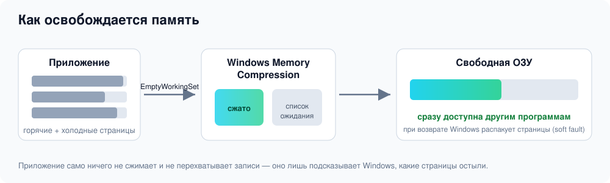

<p align="center">
  
</p>

<p align="center">
  
  
  
  
</p>

# ElasticMem

**Освобождает оперативную память штатными средствами Windows и показывает, насколько ваша память сжимается.**
Одна кнопка, без драйвера, Hyper-V и активации Windows. Для своих приложений права администратора не нужны.

> Это рабочая версия приложения. Экспериментальные направления живут в ветке [`claude/research`](../../tree/claude/research), архив мёртвого кода — в [`claude/junkcode`](../../tree/claude/junkcode).

## Установка

1. Распакуйте архив.
2. Запустите `install.cmd` (обычная установка) или `install-autostart-all.cmd` (с автозапуском агента при входе).
3. Программа появится в меню «Пуск» → **ElasticMem**. Удаление: `C:\Program Files\ElasticMem\uninstall.ps1`.

Без установки можно просто запустить `ElasticMem.exe` — он self-contained, .NET ставить не нужно.

## Как это работает

<p align="center">
  
</p>

Приложение само ничего не сжимает и не перехватывает записи (у CPU нет бесплатного перехвата записи
в чужую память). Вместо этого оно уменьшает рабочий набор холодных приложений: Windows Memory
Compression сжимает выгруженные страницы, и память сразу доступна другим программам. При возврате к
приложению страницы распаковываются автоматически — обычно незаметно (soft fault).

## Разделы приложения

| Раздел | Что делает |
|---|---|
| 🧹 **Освободить память** | Одна кнопка. Реальный замер общесистемной ОЗУ до/после. |
| 🎮 **Игры и приложения** | Профили популярных программ (Chrome, Steam, Telegram…) и тест: сколько памяти вернулось. |
| ♻️ **Фоновый агент** | Постоянно держит рабочий набор у «горячего» объёма. Активное окно и игры с античитом не трогает. |
| 🔬 **Проверка** | Измерительные инструменты: *Сжатая куча* (своя XPRESS-память), *Анализ памяти* (только чтение), *Бенчмарк* рантайма. |
| 📜 **Журнал** · ⬆️ **Обновление** · ❔ **О программе** | Служебные разделы. |

## Честные ограничения

- Уменьшение рабочего набора **не всегда равно** экономии физической RAM или commit; возможны рост
  страничных ошибок и задержки. Перед использованием сравните систему с выключенным агентом.
- Прозрачно работать со сжатой памятью **чужого** процесса без рантайма/драйвера/аппаратуры нельзя —
  поэтому для произвольных программ используется сжатие в паузах средствами самой Windows.
- Агент не ускоряет программы; его польза — освободить ОЗУ под активные задачи.

## Командная строка

```bat
ElasticMem.exe --agent --all --tray                 :: фоновый агент для всех приложений, в трей
ElasticMem.exe --agent --process chrome --min-idle 60 :: только для chrome.exe
ElasticMem.exe --selftest                            :: самопроверка движка
ElasticMem.exe --scan telegram,chrome,steam          :: отчёт по приложениям (только чтение)
```

## Сборка из исходников

```bash
dotnet publish src/ElasticMem.App -c Release -r win-x64 --self-contained \
  -p:PublishSingleFile=true -p:EnableCompressionInSingleFile=true
```

Тесты ядра:

```bash
dotnet run --project tests/ElasticMem.Tests -c Release -- --bench
```

## Структура

```
src/ElasticMem.App    — приложение (WinForms)
src/ElasticMem.Core   — движок: кодеки, микроблоки, ElasticStore, политики
tests/                — тесты ядра (кодеки, хранилища, политики)
installer/            — install.cmd / install.ps1 / uninstall.ps1
docs/                 — документация и диаграммы
```

## Лицензия

MIT.
