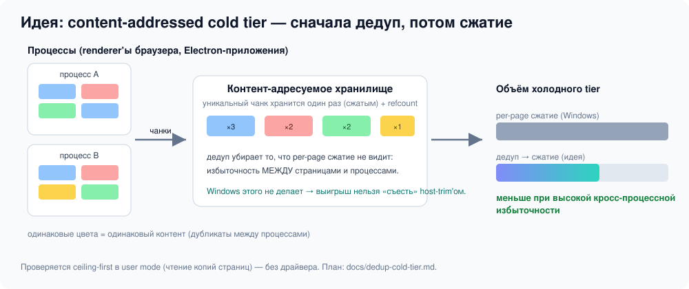

<p align="center">
  
</p>

<p align="center">
  
  
  
</p>

# ElasticMem — ветка research

Полное дерево со **всеми экспериментальными направлениями** проекта. Рабочее приложение живёт в
ветке [`main`](../../tree/main); здесь — то, что исследуется или нативно ещё не доведено. Главный
принцип: **ничего не выдаём за экономию физической RAM без доказательства**, нативные замеры всегда
отделены от переносимых (portable) тестов.

## Что здесь исследуется

| Направление | Где | Статус |
|---|---|---|
| Сжатие в реальном времени (предиктивный рабочий набор) | `src/ElasticMem.App/RealtimeCompression.cs` | экспериментально, нативно не измерено |
| Прозрачная сжатая куча (VEH + `PAGE_NOACCESS`) | `src/ElasticMem.App/ElasticHeap.cs` | падала в 0.36; движок измеряется отдельно |
| Свой VMM-пейджер на WHP | `src/ElasticMem.Vmm/` | тупик host-trim (Windows сама вытесняет) |
| Kernel-хранилище `ElasticMemStore.sys` | `driver/` | KMDF-исходники; тот же XPRESS, что и Windows |
| Backend VM (Hyper-V + RDS RemoteApp) | `src/ElasticMem.App/Backend/`, `backend/` | не тестировалось нативно |
| `ElasticArray64` / выборочный доступ к сжатому | `src/ElasticMem.Core/Access/` | библиотека + бенчмарки |
| FPGA-прототип BΔI | `hardware/` | RTL/Verilog, синтез под ECP5 |
| **Content-addressed cold tier (дедуп)** | `docs/dedup-cold-tier.md`, `src/ElasticMem.Core/Research/DedupCeiling.cs` | **новое — ceiling-эксперимент** |

## 💡 Новое направление: дедупликация как новый принцип памяти

Всё, что проект пробовал раньше, сжимает каждую страницу **независимо** — как и сам Windows Memory
Compression. Неисследованная ось — **избыточность между страницами и между процессами**.

<p align="center">
  
</p>

Идея: резать память на **чанки контента**, уникальный хранить один раз (сжатым), дубликаты — ссылкой
со счётчиком. Это ловит огромное пересечение между renderer-процессами браузера и Electron-приложениями,
которого per-page сжатие структурно не видит. В отличие от убитого WHP-пейджера, Windows этого не делает
никогда — значит выигрыш нельзя «съесть» host-trim'ом. Полное предложение и план:
[`docs/dedup-cold-tier.md`](docs/dedup-cold-tier.md).

### Запустить ceiling-эксперимент

```bash
# самопроверка на синтетике (~60% дубликатов между «процессами»)
dotnet run --project tests/ElasticMem.Tests -c Release -- --skip-tests --dedup-ceiling

# на реальных дампах 4-КиБ страниц (*.bin) со многих процессов
dotnet run --project tests/ElasticMem.Tests -c Release -- --skip-tests --dedup-ceiling C:\dumps
```

Метрики: доля уникальных чанков (fixed 4K/512/64 и CDC≈512) и объём «дедуп → сжатие» против per-page.
Gate: кросс-процессный дедуп ≥ ~20% → делать user-mode дедуп-store; < ~5% → честно закрыть направление.

## Другие эксперименты (CLI)

```bash
dotnet run --project tests/ElasticMem.Tests -c Release -- --micro     # выборочный доступ к сжатому
dotnet run --project tests/ElasticMem.Tests -c Release -- --access    # выбор формата по стоимости доступа
dotnet run --project tests/ElasticMem.Tests -c Release -- --linked    # связанные буферы (закрыто, оставлено для истории)
```

## Ветки проекта

- [`main`](../../tree/main) — рабочее приложение.
- `claude/research` (эта) — все исследования + архив полного дерева.
- [`claude/junkcode`](../../tree/claude/junkcode) — опись мёртвого/закрытого кода.

## Лицензия

MIT.
